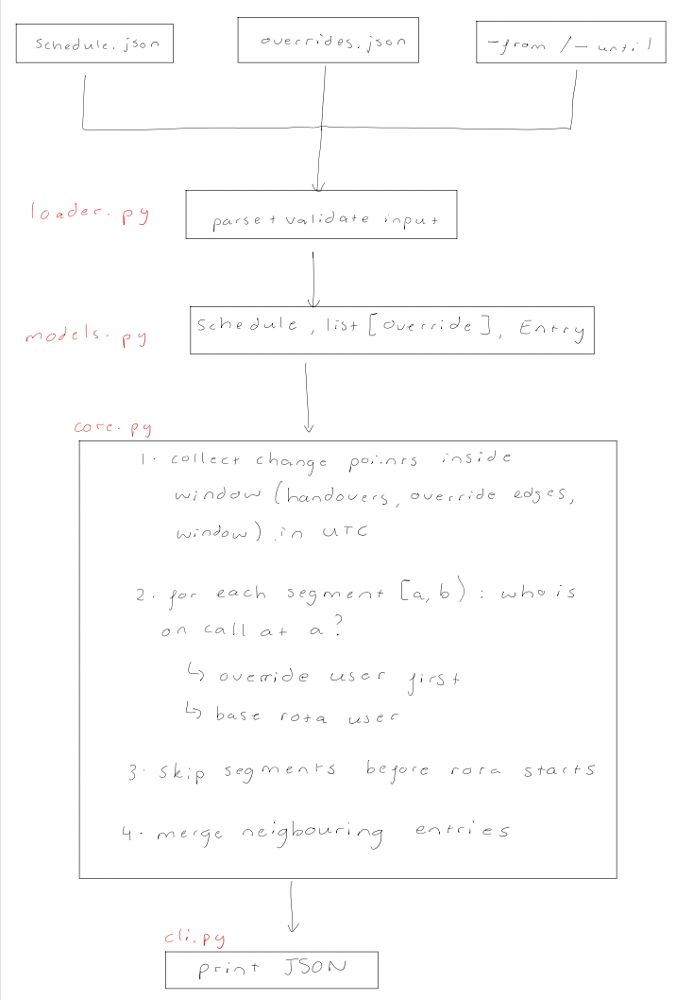
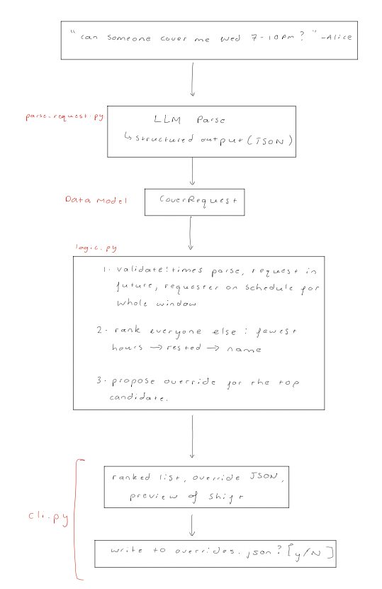

# On-call schedule renderer
`./render-schedule` takes an on-call rota (schedule) and a list of overrides and prints the final schedule for a time window as JSON. Overrides are applied, and entries are trimmed to the window.

I also implemented an extension, `./cover-request`, which turns a plain-English request like *"can someone cover me Wednesday 7-10pm?"* into a fair, validated override. See [Extension: cover requests](#extension-cover-requests).

**Video walkthrough:** https://youtu.be/nh3jYjg6xFQ

[](https://youtu.be/nh3jYjg6xFQ)

## Quick start
Requires **Python 3.10+**. The core logic only uses the standard library, so nothing needs installing to run it.

```console
$ ./render-schedule \
    --schedule=examples/schedule.json \
    --overrides=examples/overrides.json \
    --from='2026-11-06T17:00:00Z' \
    --until='2026-11-20T17:00:00Z'
```

This prints exactly the output given in the brief (`examples/` contains the brief's example input).

`--overrides` is optional. Times must be ISO 8601 with a timezone, and output is always UTC. Invalid input prints `error: ...` to stderr and exits with code 1.

### Running the tests
```console
$ python3 -m venv .venv && source .venv/bin/activate
$ pip install -r requirements-dev.txt
$ pytest
```

## How it works
This diagram shows the end-to-end flow:



### Key idea: change points
My scheduling algorithm is based on one key idea: the person on call can only change at a few specific moments. These moments are:
- a **handover** in the rota (every `handover_interval_days` from `handover_start_at`)
- the **start or end of an override**
- the **edges of the requested window**

Between two consecutive change points, nobody changes. So the algorithm:
1. Collects every change point strictly inside `[from, until)`, plus `from` and `until` themselves, then sorts them.
2. For each pair of neighbouring points, asks **who is on call at the start of that segment**:
    - if an override covers that moment, it is that person
    - otherwise it is the person on the base rota: shift number `k = (t - handover_start_at) // interval`, user `users[k % len(users)]`
3. Skips segments before the rota starts, where no one is on call.
4. Merges neighbouring entries with the same person, so a split shift is shown as one entry.

The running time depends on the number of handovers and overrides in the window, not on how long the window is or how fine-grained the times are. A year-long window with a weekly rota needs about 52 segments, not 8,760 hourly checks.

### Code map

| File | Responsibility |
|---|---|
| `scheduler/models.py` | Frozen dataclasses: `Schedule`, `Override`, `Entry` |
| `scheduler/loader.py` | Reading JSON, parsing and formatting times, validating input |
| `scheduler/core.py` | The algorithm: pure functions, no I/O |
| `scheduler/cli.py` | Flags, then load, render, print; errors go to stderr with exit code 1 |
| `render-schedule` | Executable entry point |

## Design decisions
I considered three different approaches to the problem:

| Approach | Problem |
|---|---|
| Step through time (e.g. hourly) and ask who's on call | Slow for long windows, and wrong for overrides that don't start on the hour |
| Generate rota shifts, then cut overrides into them | Works, but splitting intervals when overrides overlap or span handovers is fiddly and easy to get wrong |
| **Change points** (chosen) | Exact, fast, and each step is a small pure function that is easy to test |

**Half-open intervals `[start,end)`** - A shift ending at 17:00 and the next one starting at 17:00 don't overlap, so there's no double-counting at handovers.

**UTC everywhere** - Input times must include a timezone (`Z` or `+01:00`); times without one are rejected rather than guessed. Everything is converted to UTC straight away and printed in the brief's `...Z` format.

**Pure core, I/O at the edges** - `core.py` never touches files or the clock. It takes in dataclasses and returns dataclasses. All parsing and validation happens in `loader.py`, so the algorithm only ever sees valid data.

### Edge-case behaviour
- **Overlapping overrides:** the brief guarantees overrides won't overlap, but if they did, the first matching override in the file would win.
- **Window starts before the rota:** no one is on call yet, so those times are left out of the output rather than raising an error.
- **Same person twice in a row** (e.g. a one-person rota, or an override for whoever is already on call): merged into one entry.
- **Override user not on the rota:** allowed, since covering for a team you're not on is a realistic case.
- **Validation:** rejects only input that would crash or loop forever: no users, a handover interval of 0 or less, an override that ends before it starts, `--from` not before `--until`, or an overrides file that isn't a JSON array.

## Testing
The renderer is tested at four levels:

| Layer | File | What it checks |
|---|---|---|
| **Unit**  | `tests/test_core.py` | Each helper on its own: `base_user_at`, `on_call_at`, `handovers_between`, `merge_adjacent` |
| **Scenarios** | `tests/test_core.py` | The brief's example, plus edge cases: window before the rota, overrides spanning handovers, back-to-back and overlapping overrides, one-person rotas, windows smaller than a shift, override edges exactly on the window edges |
| **End-to-end** | `tests/test_cli.py` | The real CLI with real files: JSON output, exit codes, error messages for bad input |
| **Property-based**  | `tests/test_properties.py` | Random rotas, overrides and windows generated with [Hypothesis](https://hypothesis.readthedocs.io/) |

### A note on property tests

The property tests compare `render_schedule` with a deliberately simple, separate
implementation that checks every hour one by one. They also check that, for any
input:

- entries are sorted, don't overlap, and stay inside the window
- there are no gaps once the rota has started
- no two neighbouring entries have the same person
- an override always wins wherever it applies

The extension adds 27 more tests: validation, ranking and tie-breaks, LLM output
parsing, and the CLI in `--mock` mode. None of them call the API.

## Extension: cover requests
Instead of just coming up with extra product ideas, I wanted to implement one myself - I came up with automated cover requests.

When someone needs a few hours off during their shift, finding cover today means asking in Slack, waiting, and then someone manually adding an override. `./cover-request` automates that:

```console
$ ./cover-request "can someone cover me Wednesday 7-10pm? I'm going to the cinema" \
    --as alice --schedule examples/schedule.json --overrides examples/overrides.json

Cover request: alice, 2026-11-11T19:00:00Z -> 2026-11-11T22:00:00Z
Reason: cinema

Suggested cover:
  1. charlie: 130h on call in ±14d, rested
  2. bob: 168h on call in ±14d, rested

Proposed override:
{ "user": "charlie", "start_at": "2026-11-11T19:00:00Z", "end_at": "2026-11-11T22:00:00Z" }

Schedule preview with the override:
  alice      2026-11-09T22:00:00Z -> 2026-11-11T19:00:00Z
  charlie    2026-11-11T19:00:00Z -> 2026-11-11T22:00:00Z   <- cover
  alice      2026-11-11T22:00:00Z -> 2026-11-13T17:00:00Z

Write this override to examples/overrides.json? [y/N]
```

### How it works


**The LLM only handles the fuzzy part.** Claude turns the message into a structured output `{start_at, end_at, reason}`, so the API guarantees the JSON shape. The prompt includes the current date so it can work out what "tomorrow" or "next Wednesday" means.

**Everything that decides who gets paged is deterministic**. The model's output is never trusted:
- **Validation**: the times must parse, be in the future and the requester must be on call for the whole of the request window. A request spanning a handover, or one already covered by an override, is rejected with the name of whoever is actually on call.
- **Rank**: everyone who can cover is sorted by:
    1. fewest hours on call in the 14 days either side (existing overrides count)
    2. whether or not the person covering is rested (rested is true if they are not on call within 12 hours either side of the requested window)
    3. name, so the result is the same every time
- **Preview**: the requester's shift with the override applied, with the cover highlighted in green. The user is then asked before anything is written: use the flag `--write` to skip the question.

### Try it without an API key

`--mock` skips the LLM and takes the times as flags:

```console
$ ./cover-request "cinema" --as alice --schedule examples/schedule.json \
    --mock --start 2026-11-11T19:00:00Z --end 2026-11-11T22:00:00Z
```

To use the LLM, run `pip install -r requirements.txt` and
`export ANTHROPIC_API_KEY=...`.

### Files

| File | Responsibility |
|---|---|
| `scheduler/cover/logic.py` | Validate, rank, propose an override (pure, no LLM) |
| `scheduler/cover/parse_request.py` | The only code that talks to the LLM |
| `scheduler/cover/cli.py` | Flags, preview, confirmation prompt |

The extension imports from the core, but the core never imports from the
extension. Deleting `scheduler/cover/` leaves `render-schedule` untouched.

## Assumptions and limitations

- **Overrides are trusted** - Overlapping overrides are resolved (the first in the
  file wins) rather than rejected, and an override can name someone outside the
  rota.
- **UTC only** - Output is always UTC; there's no per-user timezone. "7pm" in a
  cover request is read as 7pm UTC.
- **Whole-day handover intervals** - `handover_interval_days` can be any positive
  number, but there's no support for more complex rotas (e.g. weekday/weekend
  splits, follow-the-sun across regions).
- **Fairness is simple** - Ranking counts raw hours on call. A 3am hour counts the
  same as a 3pm hour, and taking cover isn't remembered as a favour owed.
- **Ranking order is a judgement call** - Fewest hours beats being rested, so the
  top suggestion can be someone whose own shift starts right after the cover.
  Putting rest first is a one-word change; which is right depends on the team.
- **Single file, single user** - `--write` edits a local JSON file with no locking.
  In a real product this would be a database, with concurrent edits handled.

## Future work
**1. Daylight-saving-aware handovers.** Teams think in local time ("Monday 9am
London"), but the rota is stored as fixed UTC intervals, so after the clocks change
every handover silently shifts by an hour. I'd store the handover as a local time
plus a timezone (`zoneinfo`) and work out each handover from local calendar dates,
so shifts crossing a clock change are correctly 167 or 169 hours. The change-point
algorithm only cares where the handovers are, so only `base_user_at` and
`handovers_between` would need to change.

**2. Schedule health checks.** A `--check` mode that renders the coming weeks and
warns about gaps with no one on call, overlapping overrides (one is currently
ignored without warning), anyone on call for too long without a break, and overrides that change
nothing. Each check is a simple pass over the rendered entries. It would exit with
a non-zero code so it can run in CI on every schedule change, or nightly with a
Slack alert: *"next Saturday 02:00–06:00 has no one on call"*.

**3. Alert-weighted fairness.** Hours on call is a poor measure of burden: a quiet
week and a week of 3am pages count the same. I'd assign each past alert to whoever
was on call at the time (using `on_call_at`), weight night and weekend pages more
heavily, and use the result to build fairness reports and to order the next
rotation so the most burdened people get a lighter turn.
